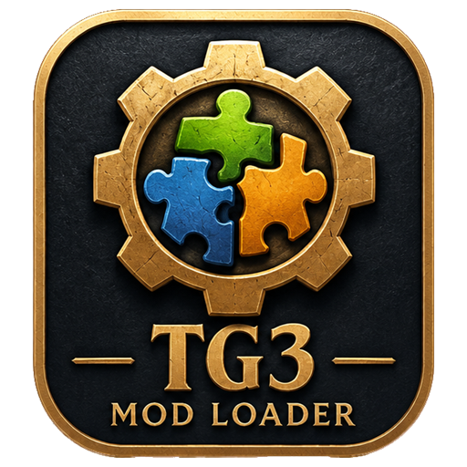
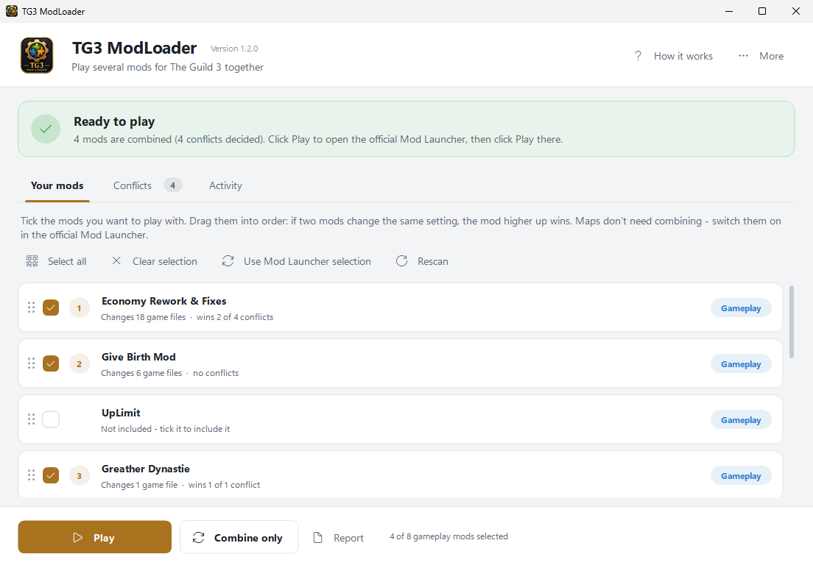
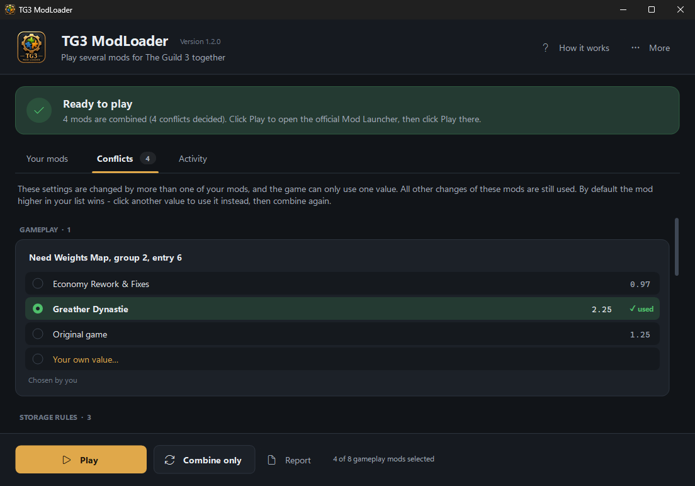

# TG3 ModLoader

<p align="center"></p>

Merges several mods for **The Guild 3** into one conflict-free mod, so that mods which edit the
same files can be used together while keeping their full functionality.

End-user documentation: [README.txt](README.txt) (also copied into the mod folder).
Changes: [CHANGELOG.md](CHANGELOG.md).

## Installation

**Steam Workshop:** subscribe to *TG3 ModLoader* in the Workshop of The Guild 3. Start it from the
official Mod Launcher (select *TG3 ModLoader*, click **Mod files**, double-click `TG3ModLoader.exe`);
on the first start it offers a desktop shortcut. A Workshop copy keeps its settings and the combined
mod in `...\steamapps\workshop\content\311260\TG3ModLoader\`, because Steam replaces the item's
own folder on every update.

**Manual:**

1. Download `TG3ModLoader-<version>.zip` from the [Releases](https://github.com/Kleator/TG3ModLoader/releases) page.
2. Extract it into the Steam Workshop folder of the game, so that the program ends up at
   `...\steamapps\workshop\content\311260\TG3ModLoader\TG3ModLoader.exe`
   (`311260` is the Steam app id of The Guild 3; the folder sits next to the numbered folders of
   your subscribed mods). A manual and a Workshop copy share their settings.
3. Start `TG3ModLoader.exe`, tick the mods you want, drag them into order (the mod at the top wins
   when two mods change the same setting) and click **Combine & Play**. The official Mod Launcher
   opens - click **Play** there.

Requires Windows 10/11 (.NET Framework 4.8 is part of Windows) and Steam with The Guild 3 installed.

## The user interface

<p align="center">
  
  
</p>

The window is made for players, not modders:

* A **status box** at the top always says what to do next - *Welcome*, *Not combined yet*,
  *Please combine again* (selection, order, a conflict choice or a mod update changed) or
  *Ready to play*.
* **Your mods** - the mods as cards: tick them, drag them into order (or use the arrows on hover,
  Alt+Up/Down), see per mod how many game files it changes and how many conflicts it wins.
  Right-click for its folder or Steam Workshop page. Maps are shown but need no combining.
* **Conflicts** - every setting that several selected mods change differently, grouped by game
  area with readable names ("Buildable Products In Front Store Amount - Custom Rules > Default
  Storage Rule 13"). One click picks the winner: another mod, the original game's value or an own
  value; changed choices are marked until the next combine.
* **Activity** - the detailed log (copy to clipboard for support requests).
* One main button: **Combine & Play**, or just **Play** when everything is up to date.
* **Report** - an HTML summary of the last combine (mods, conflicts, notes in plain words; the
  technical file list is folded away). It is always written with the current layout, also from
  combinations made by an older version.
* **Light and dark mode** follow the Windows setting automatically, also while the program is open
  (including the title bar); the report follows the browser/Windows setting.
* The custom controls expose themselves to screen readers (MSAA/UI Automation) and are usable with
  the keyboard (Ctrl+1/2/3 or Ctrl+Tab switch tabs, Space ticks a mod, F1 help, F5 rescan).

## The problem

* Script mods have to ship the **complete** script set of the game (about 2000 `.oc/.oo/.inc`
  files from `Modding/TG3_Scripts.zip`), because `Guild3.exe -mod <folder>` loads all scripts from
  the mod folder.
* The official Mod Launcher (`Modding/Guild3ModLauncher.exe`) copies every enabled mod into
  `%LOCALAPPDATA%\Guild3ModLauncher\mod` and aborts on the first file that already exists
  (`error copying mod: ...`). Two script mods therefore always collide - even if they change
  completely different values.
* Almost every mod edits `media/base/guild3/GameplayDefault.oc`.

## The solution

The ModLoader treats vanilla as the common base and performs a **three-way merge** of every file
that more than one mod changes:

1. Every mod file is compared with vanilla. Files that are identical to vanilla (the usual
   unchanged copies) are ignored, so only real changes take part in the merge.
2. Files changed by one mod are taken over unchanged.
3. Files changed by several mods are merged:
   * **Script files** (`.oc .oo .inc .loo`) are parsed into a lossless syntax tree (every token keeps
     its whitespace and comments). Each mod is diffed against vanilla on that tree and all changes
     are combined:
     * properties (`Key = value;`), named blocks, functions and map entries are matched by key,
     * list elements (`array { ... }`, tuples, `@base/...` includes, anonymous objects such as
       `ModifierEffect { ... }`) are aligned with identity fields (`Key`, `Name`, `ID`, `Id`,
       `ActionName`, ...) or with a content LCS plus similarity pairing,
     * additions of several mods at the same place are all kept (identical additions only once),
     * only when two mods change the **same** value differently does the priority decide
       (the mod at the top of the list has the highest priority; additions of several mods at the
       same place are combined in list order). These are reported as conflicts; for each location the user can choose a
       different mod, the vanilla value or an own value (`conflictOverrides` in
       `ModLoader.config.json`: `"file::path": "<modId>"` or `"=<value>"`). Numerically equal values
       (`4`, `4.0`, `4.0f`) are not conflicts.
     * keys that occur several times in one container (e.g. `RequiredBuilding = ...` lists) are
       treated as list elements, not as keys.
     * Localization (`.loo`) is merged additively (entries are never removed).
   * **Other text files** (UI `.Slate` layouts, ...) use a line-based diff3 merge.
   * **Binary files** (textures, sounds, ...) use the priority.
4. Unchanged regions are written byte-for-byte from their source, so the output stays as close as
   possible to the original files.
5. A **verifier** re-parses every merged file and checks, for every mod, that each of its changes
   is present in the result or explained by a recorded conflict.

The result is written to `TG3ModLoader/MergedMod`, which is registered as a folder mod in the
official Mod Launcher (`mods.yml`: `name: <path>`, `id: 0`). The individually merged mods are
disabled there, map-only mods stay untouched.

## Project layout

```
src/
  Script/Lexer.cs, Parser.cs   lossless lexer/parser for the Guild 3 script language
  Merge/Matcher.cs             child alignment (keys, identity fields, LCS, similarity)
  Merge/TreeMerger.cs          structural three-way merge + conflict policy
  Merge/LineMerger.cs          line-based diff3 fallback
  Merge/Verifier.cs            change preservation check
  Merge/Out.cs                 output model / emitter
  Util/                        diff (LCS), tar/zip reader, JSON, text decoding
  Core/GameEnv.cs              game/workshop/launcher path detection
  Core/LauncherConfig.cs       reads/writes the launcher's mods.yml
  Core/ModCatalog.cs           scans Workshop and folder mods
  Core/ToolConfig.cs           ModLoader.config.json (selection, order, overrides)
  Core/Builder.cs              merge pipeline, output, manifest, launcher update
  Core/ReportData.cs           everything the report shows; stored in the manifest so the report
                               can be written again at any time
  Core/ReportWriter.cs         HTML report (light/dark via prefers-color-scheme)
  Core/Friendly.cs             player wording for script paths, file areas, values and notes
  Core/TestRun.cs              starts the game with the mod and checks for script errors/crashes
  Core/SelfTest.cs             parser round-trip and pairwise merge tests
  Gui/Theme.cs                 light/dark palettes, Windows theme detection, fonts, icons
  Gui/UiKit.cs                 owner-drawn controls: buttons, tabs, status box, mod list,
                               conflict list, dialogs (with accessibility objects)
  Gui/MainForm.cs              main window
  Program.cs                   entry point and command line
deploy.sh                      build + copy into the Workshop folder
```

## Building

Requires the .NET SDK (any recent version) and the .NET Framework 4.8 targeting pack (installed
with Windows / Visual Studio). The output is a single `TG3ModLoader.exe` that runs on every
Windows 10/11 machine without installing anything.

```sh
sh deploy.sh                                   # build only (output in build/)
sh deploy.sh "<steamapps>/workshop/content/311260/TG3ModLoader"   # build and install
```

## Command line

```
TG3ModLoader.exe                         GUI
TG3ModLoader.exe build [--mods id1,id2] [--all] [--import-launcher] [--no-launcher] [--dry-run] [--launch]
TG3ModLoader.exe status | import-launcher | launch
TG3ModLoader.exe resolve "<file>::<path>" <modId | =value | clear>
TG3ModLoader.exe report [--out file.html]
TG3ModLoader.exe unregister
TG3ModLoader.exe selftest [--no-pairs]
TG3ModLoader.exe testrun [--dir <modfolder>] [--vanilla] [--timeout 600] [--screenshot file.png]
```

## Verification

`TG3ModLoader.exe selftest` runs two test suites against the installed game and mods:

1. **Lossless parsing** - every vanilla script, every game localization file and every script
   file of every installed mod is parsed and written back; the output must be byte-identical.
2. **Trial merges** - every pair of installed content mods (in both orders) and all of them
   together are merged in memory; the verifier must confirm that every change of every mod is
   present in the result or explained by a recorded conflict.

`TG3ModLoader.exe testrun` starts the game with a mod folder exactly like the Mod Launcher does
(`Guild3.exe -mod <folder>`), waits for the main menu and reports script error dialogs,
`scripts.log` messages and crashes (new Sentry dump). A deliberately broken script mod is detected
as a crash, a plain vanilla copy loads fine - so the test run distinguishes both cases.

## Compatibility analysis of the installed mods (2026-10-19)

| Mod | Workshop ID | Type | Changes vs. vanilla |
|---|---|---|---|
| Economy Rework & Fixes | 3000764164 | scripts + localization | 7 files changed, 12 added |
| UpLimit | 3034330763 | scripts | GameplayDefault.oc |
| Give Birth Mod | 3057663769 | scripts + icons | 3 files changed, 3 added |
| Greather Dynastie | 3048767103 | scripts | GameplayDefault.oc |
| Improved Barber | 3011763339 | scripts | 6 files changed |
| Mistgrove Adapt | 3023152437 | scripts | 56 files changed (contains a syntax error in GeneralCharacterLevelSettings.oc) |
| Mistgrove, Brisbane, Gangs of New York | 3020731259, 3004252959, 3240316180 | maps | - |

* **Official launcher alone:** every pair of the six script mods overlaps in all 2003 script files,
  so all 15 combinations fail with `error copying mod`. Only combinations of one script mod with map
  mods work (21 of 36 pairs).
* **With the ModLoader:** all 15 pairs (both orders) and all six mods together merge with 0
  verification errors. 57 real conflicts remain when all six are combined - mostly economy values
  that *Economy Rework* and *Mistgrove Adapt* both tune, and family size limits set by *UpLimit*,
  *Greather Dynastie* and *Mistgrove Adapt*. All of them are listed in the report and can be
  decided per location.
* **In-game test runs** (main menu reached, no script error, no crash):
  * each of the six script mods alone - OK (the missing bracket in *Mistgrove Adapt* is tolerated);
  * all six merged by the ModLoader - OK, started directly and through the official Mod Launcher
    together with the *Mistgrove* map (launcher log: both mods copied without conflict, game
    launched, mod id `FCC71AEB` - identical for both starts);
  * synthetic mods covering new actions via new `.inc` files and `@base` includes, a new file
    added by two mods, new localization keys, list entries removed/added by different mods in the
    same list, a deleted vs. modified property, a custom conflict value, a UI `.Slate` layout and a
    binary file conflict - OK;
  * negative controls: a deliberately broken script is detected as a crash, a vanilla copy loads.

## Facts about the game that the ModLoader relies on

* `Guild3.exe -mod <folder>` loads `media/` (and `maps/`) from the folder; the main menu then shows
  `(Mod: XXXXXXXX)`.
* The launcher writes `%LOCALAPPDATA%\Guild3ModLauncher\mods.yml` (`- cl: ""`, then `name/id/enabled`
  per mod; folder mods use the path as `name` and `id: 0`). A non-numeric id crashes the launcher.
* Launcher order: the first entry is copied first. The launcher never overrides files - a duplicate
  file aborts the copy. The ModLoader's own list uses "top = highest priority".
* A fatal script syntax error makes the game crash while loading (Sentry dump in
  `%LOCALAPPDATA%\Guild3\sentry\reports`); `loadingtime.log` in the game folder contains
  `FINISHED` after `STARTED: main` once the main menu is loaded.
* Savegames are stored per mod id (`Saved Games\Guild3\<SteamID>\<ModId>\`). The mod id is derived from
  the script content only (the same content in a different folder, with or without map mods, shows the
  same id). The merge output is deterministic, and it is written incrementally so that re-merging
  without changes does not touch any file.
* The vanilla game itself tolerates mismatched brackets (`{ ... )`) and a missing closing bracket at the
  end of a file - the parser accepts the former; the latter is reported as a note and the file is
  merged line by line.
* The game cannot open paths with 260 or more characters - a mod folder that deep makes it crash while
  loading. The ModLoader warns when its output (or the launcher copy) would exceed that limit, and the
  test run refuses such folders. The ModLoader itself uses `\\?\` long paths.
* The launcher changes the current directory to the game folder and starts `Guild3.exe` relatively.
  Automation that sets `NoDefaultCurrentDirectoryInExePath` (some developer shells do) makes the launch
  fail with "file not found"; normal desktop sessions are not affected.
